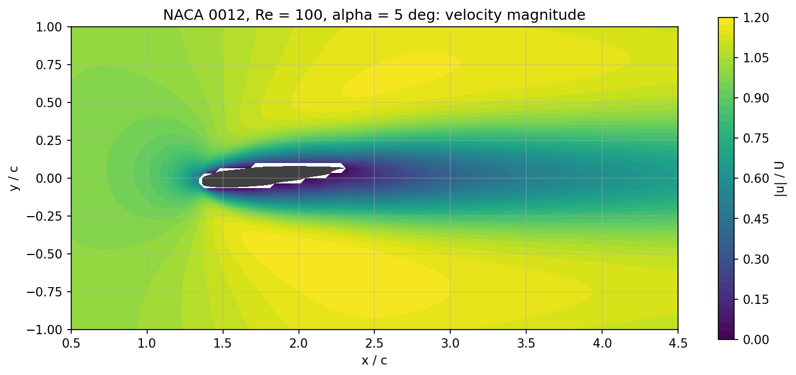
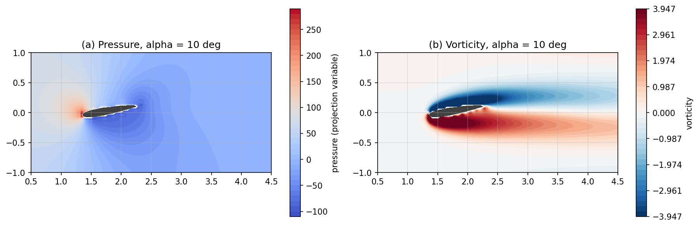
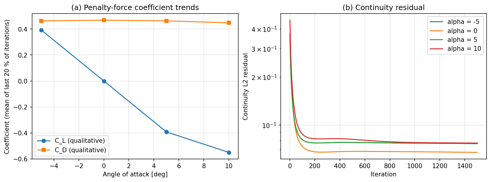

# Experiment 1: External Flow over a NACA 0012 Airfoil

**Author:** 23BME048  
**Date:** October 2026

## Aim
Study how the angle of attack changes the velocity field, wake, pressure distribution and qualitative lift/drag trends around a NACA 0012 airfoil at $Re = 100$.

## Governing Equations
Incompressible, laminar Navier–Stokes equations with a Brinkman volume-penalisation term that represents the solid:

$$ \nabla\cdot\mathbf{u} = 0, \qquad \frac{\partial \mathbf{u}}{\partial t} + (\mathbf{u}\cdot\nabla)\mathbf{u} = -\nabla p + \frac{1}{Re}\nabla^2\mathbf{u} - \frac{\chi}{\eta}\,\mathbf{u} $$

$\chi$ is a smoothed solid mask (1 inside the airfoil, 0 in the fluid) and $\eta$ is a small permeability, so the last term drives the velocity to zero inside the body. The NACA 0012 thickness is $y_t = 0.6\,(0.2969\sqrt{x} - 0.1260x - 0.3516x^2 + 0.2843x^3 - 0.1036x^4)$.

## Methodology
- Cartesian grid on a $5c \times 2.5c$ domain; leading edge at $x = 1.35c$, rotation about the quarter chord.
- Fractional-step projection: first-order upwind convection, central diffusion, explicit penalisation → Poisson equation for the pressure correction (Jacobi iterations) → velocity correction.
- Boundary conditions: uniform inflow $u=U$ at the inlet, top and bottom; zero-gradient outflow with $p = 0$.
- Forces come from integrating the penalisation term over the body. The solver labels these coefficients **qualitative**: the immersed boundary is diffuse, so trends are meaningful but the absolute values are not.

**Table 1: Parameter set.**

| Parameter | Value | Parameter | Value |
| :--- | :--- | :--- | :--- |
| Grid | 150 × 75 | Reynolds number | 100 |
| Pseudo-time iterations | 1500 | Poisson iterations / step | 100 |
| Time step | $3.36\times10^{-3}$ | Angles (solver $\alpha$) | −5°, 0°, 5°, 10° |

**Angle convention.** In `sim.py` a positive $\alpha$ rotates the chord counter-clockwise about the quarter chord. This raises the trailing edge, so with flow from left to right a positive solver $\alpha$ is a **nose-down** (geometrically negative) incidence. The results below keep the solver's $\alpha$ and interpret the signs with this in mind.

## Results & Discussion

**Flow field.** Figure 1 shows the speed field at $\alpha = 5°$. The flow stagnates at the leading edge, accelerates around the body to about $1.2U$, and leaves a long viscous wake typical of $Re = 100$.

  
*Figure 1: Velocity magnitude around the airfoil at $\alpha = 5°$.*

**Effect of angle of attack.** Figure 2 compares the four angles. At $\alpha = 0°$ the field is symmetric. As $|\alpha|$ grows, the wake tilts and widens, and the acceleration becomes stronger on one side than the other. The $\pm5°$ cases are mirror images of each other.

  
*Figure 2: Velocity magnitude for $\alpha = -5°, 0°, 5°, 10°$.*

**Pressure and vorticity.** At $\alpha = 10°$ (Figure 3) the high-pressure stagnation point sits at the leading edge on the lower side, and a low-pressure region forms over the body. The two shear layers that leave the airfoil carry opposite-sign vorticity into the wake. The negative (upper) layer is thicker because of the incidence.

  
*Figure 3: (a) pressure and (b) vorticity at $\alpha = 10°$.*

**Force trends and convergence.** Figure 4(a) averages the coefficients over the last 20 % of the iterations:

| Solver $\alpha$ | $C_L$ (qual.) | $C_D$ (qual.) | Final continuity $L_2$ |
| :---: | :---: | :---: | :---: |
| −5° | +0.392 | 0.463 | 0.076 |
| 0° | 0.000 | 0.468 | 0.067 |
| 5° | −0.392 | 0.463 | 0.076 |
| 10° | −0.550 | 0.448 | 0.077 |

$C_L$ is zero at $\alpha = 0°$ and exactly antisymmetric in $\alpha$, as it must be for a symmetric airfoil. Its sign follows the nose-down convention above. The lift slope falls between 5° and 10° (−0.078 per degree, then −0.032 per degree), which is the expected effect of the thick low-Re boundary layer. Drag hardly changes because at $Re = 100$ it is dominated by viscous skin friction. Figure 4(b) shows the continuity residual levelling off at about 0.07–0.08: a fixed number of Jacobi sweeps per step leaves a finite divergence, which is a limitation of this teaching solver.

  
*Figure 4: (a) qualitative lift and drag against angle of attack; (b) continuity residual.*

## Conclusion
The immersed-boundary projection solver captured the expected low-Reynolds-number behaviour of a NACA 0012. The symmetric case gives zero lift, lift varies antisymmetrically with the angle and its slope falls at higher incidence, drag is nearly independent of angle, and the wake deflects with incidence. The absolute force values are qualitative because of the diffuse penalised boundary and the incompletely converged pressure projection (residual ≈ 0.07).

## Files and how to run
- `sim.py`: solver from the 20ME406P Colab lab notebook (unchanged); `common.py`: its shared utilities.
- `parametric.py`: this work's parameter set, runs and figures. Run `python parametric.py`.
