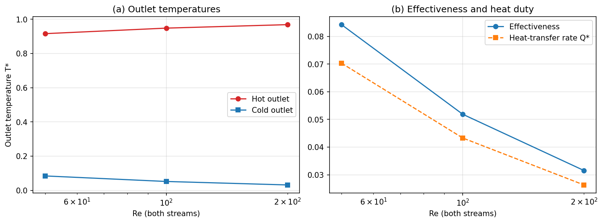
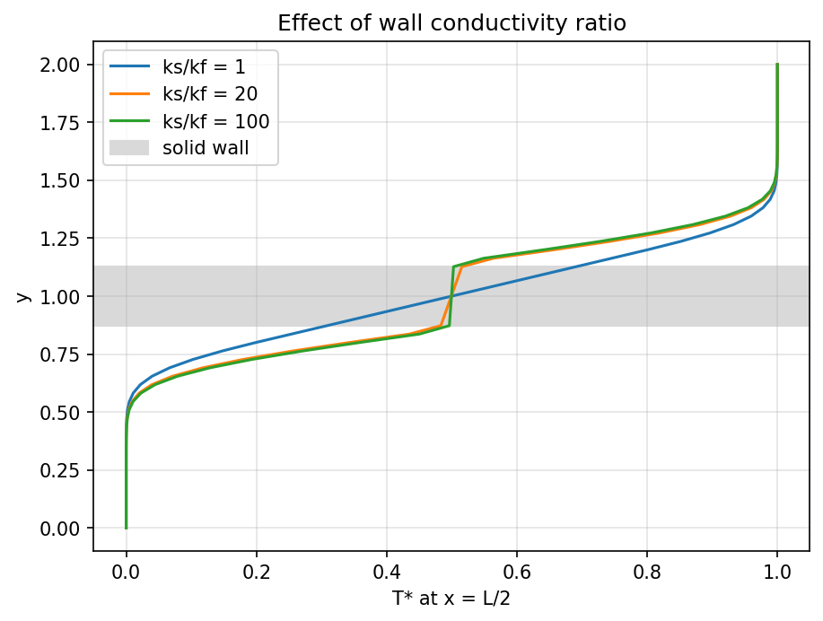
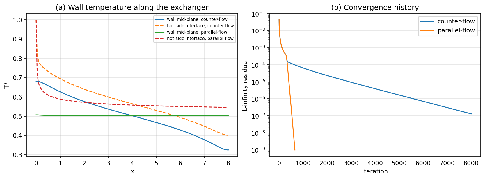

# Experiment 2: Double-Pipe Conjugate Heat Transfer

**Author:** 23BME048  
**Date:** October 2026

## Aim
Analyse heat exchange between a hot and a cold laminar stream separated by a conducting wall. Find how the Reynolds number, the wall-to-fluid conductivity ratio and the flow arrangement (counter- or parallel-flow) affect the outlet temperatures, the heat duty and the effectiveness.

## Governing Equations
Steady 2D energy equation solved on one temperature field that spans both fluids and the wall:

$$ \nabla\cdot(\mathbf{u}\,T) = \nabla\cdot(\Gamma\,\nabla T), \qquad \Gamma = \begin{cases} \dfrac{U}{Re\,Pr} & \text{fluid} \\[4pt] \dfrac{k_s}{k_f}\,\overline{\Gamma}_{f} & \text{solid} \end{cases} $$

The velocity is prescribed as fully developed parabolic profiles, $u = 6\bar U\,\eta(1-\eta)$, in each stream ($\mathbf{u} = 0$ in the wall). This isolates conjugate thermal transport from the momentum problem.

## Methodology
- Stacked 2D domain ($L = 8$, $H = 2$): cold stream (bottom), solid wall (middle), hot stream (top).
- Finite-volume discretisation: first-order upwind convection, central diffusion, and **harmonic-mean** face diffusivities, so that heat-flux continuity holds at the fluid–solid interfaces.
- Under-relaxed ($\omega = 0.82$) point-iterative solution until the $L_\infty$ change drops below $10^{-9}$ or the iteration limit is reached.
- BCs: $T_{hot,in} = 1$ at $x=0$; $T_{cold,in} = 0$ at $x = L$ (counter-flow) or $x=0$ (parallel-flow); zero-gradient outlets; adiabatic outer walls.
- Effectiveness: $\varepsilon = Q_{cold}/[\dot m_{min}(T_{h,in}-T_{c,in})]$.

**Table 1: Parameter set.**

| Parameter | Value | Parameter | Value |
| :--- | :--- | :--- | :--- |
| $n_x$ | 200 | $n_y$ cold / wall / hot | 24 / 8 / 24 |
| Prandtl number | 5.0 | Base $k_s/k_f$ | 20 |
| Base $Re$ (both streams) | 100 | Arrangement | counter-flow |
| Iteration limit | 8000 | Inlet temperatures | $T_h = 1,\ T_c = 0$ |

## Results & Discussion

**Temperature field.** In Figure 1 the hot stream heats the wall, and the wall heats the cold stream flowing the other way. Thermal boundary layers grow from both wall faces. The wall is hottest near the hot inlet ($x = 0$) and coldest near the cold inlet ($x = L$), the axial gradient characteristic of counter-flow.

  
*Figure 1: Non-dimensional temperature field for the base case.*

**Reynolds-number sweep.** Figure 2 and the table below show the trends required by the assignment.

| $Re$ | $T_{h,out}$ | $T_{c,out}$ | $Q^*$ | $\varepsilon$ | Energy imbalance |
| :---: | :---: | :---: | :---: | :---: | :---: |
| 50 | 0.9158 | 0.0842 | 0.0703 | 0.084 | $4\times10^{-14}$ |
| 100 | 0.9482 | 0.0519 | 0.0433 | 0.052 | $7\times10^{-13}$ |
| 200 | 0.9685 | 0.0315 | 0.0263 | 0.032 | $2\times10^{-13}$ |

Raising $Re$ cuts the fluid diffusivity $\Gamma = U/(Re\,Pr)$, so each stream exchanges less heat over the same length (lower NTU). Effectiveness therefore falls roughly as $Re^{-0.7}$. The hot-side loss and cold-side gain agree to machine precision, so the scheme is energy-conservative.

  
*Figure 2: (a) outlet temperatures and (b) effectiveness and heat duty against Reynolds number.*

**Conductivity ratio.** Figure 3 shows the wall-normal temperature profile at mid-length. With $k_s/k_f = 1$ the wall carries a large temperature drop and adds a significant resistance ($\varepsilon = 0.030$). At $k_s/k_f = 20$ and $100$ the wall is almost isothermal across its thickness, and the effectiveness saturates (0.0519 → 0.0525) because the fluid-side boundary layers now control the heat transfer.

  
*Figure 3: Temperature across the exchanger at $x = L/2$ for three conductivity ratios.*

**Arrangement and convergence.** Counter-flow gives $\varepsilon = 0.0519$, against $0.0491$ for parallel-flow. Figure 4(a) explains why: in counter-flow the wall temperature varies along the whole length, keeping a driving temperature difference everywhere, while in parallel-flow the wall settles at ~0.5 almost immediately. Parallel-flow converges in ~650 iterations, because information travels in one direction only. Counter-flow couples the two ends and needs the full 8000 iterations to reach a residual of $1.3\times10^{-7}$; its outlet temperatures are converged to well beyond the four digits reported.

  
*Figure 4: (a) wall temperatures along the exchanger and (b) convergence histories.*

## Conclusion
The single-field conjugate formulation with harmonic-mean diffusivities reproduced the expected heat-exchanger behaviour while conserving energy to machine precision. Effectiveness falls with Reynolds number, rises with wall conductivity until the wall resistance becomes negligible (around $k_s/k_f \approx 20$), and is higher for counter-flow. The absolute effectiveness is low because the exchanger is short compared with the thermal entry length at these Péclet numbers.

## Files and how to run
- `sim.py`: solver from the 20ME406P Colab lab notebook (unchanged); `common.py`: its shared utilities.
- `parametric.py`: this work's parameter set, runs and figures. Run `python parametric.py`.
