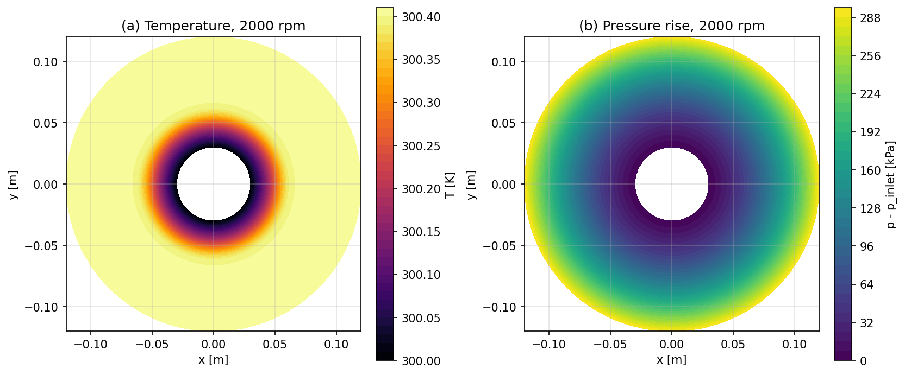
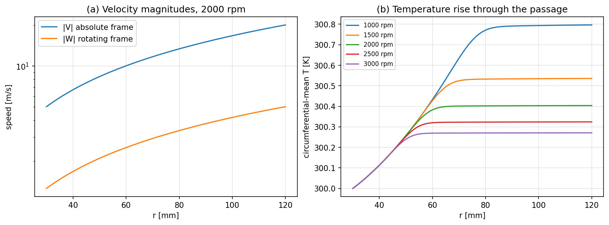
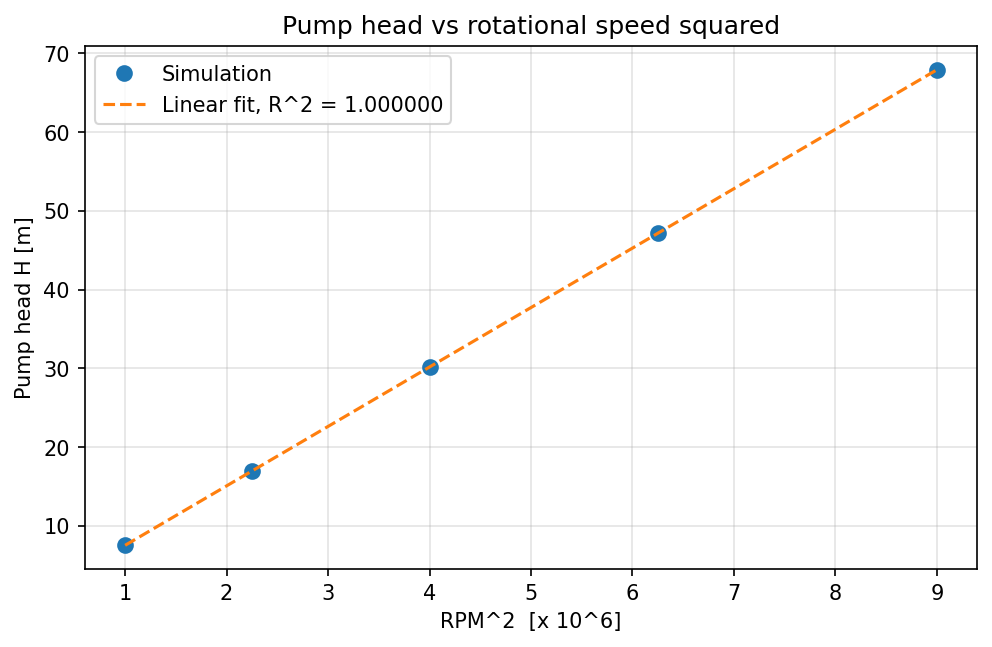
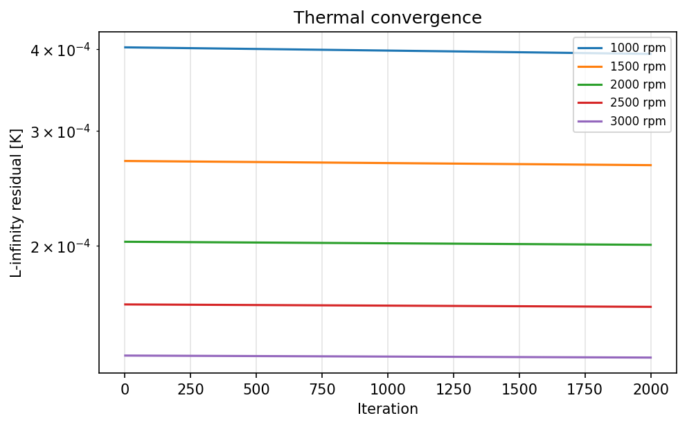

# Experiment 3: Centrifugal Pump (Single Rotating Frame Model)

**Author:** 23BME048  
**Date:** October 2026

## Aim
Study the pressure rise, pump head, velocity components and temperature rise in a simplified rotating annular passage, and test the expected scaling of head with $RPM^2$.

## Governing Equations
The passage is an annulus $r_1 \le r \le r_2$ in a single rotating frame (SRF) at angular speed $\Omega$. The velocities are prescribed:

$$ u_r = U_{in}\frac{r_1}{r}, \qquad V_\theta = s\,\Omega r \ \text{(absolute)}, \qquad W_\theta = (s-1)\,\Omega r \ \text{(relative)} $$

where $s$ is the slip/swirl factor. The pressure field is the centrifugal pressure rise minus a viscous channel loss:

$$ p(r) = \tfrac12\rho\,\Omega^2 (r^2 - r_1^2) - \frac{12\,\mu\,U_{in} r_1}{d^2}\ln\frac{r}{r_1}, \qquad H = \frac{\Delta p}{\rho g}. $$

Temperature follows a steady convection–diffusion equation in polar coordinates, with a wall heat-transfer sink/source $h(T_w - T)$ and a loss-heating source proportional to $\Omega^2 r\,u_r$.

## Methodology
- Polar grid $(n_r \times n_\theta)$, periodic in $\theta$.
- Upwind convection in $r$ and $\theta$ (using the relative tangential velocity) and central diffusion, solved iteratively with under-relaxation 0.85.
- BCs: $T = T_{in}$ at $r_1$, zero gradient at $r_2$.
- Water properties: $\rho = 997$ kg/m³, $\mu = 10^{-3}$ Pa·s, $c_p = 4180$ J/kg·K. Geometry: $r_1 = 30$ mm, $r_2 = 120$ mm, depth 10 mm.

**Table 1: Parameter set.**

| Parameter | Value | Parameter | Value |
| :--- | :--- | :--- | :--- |
| Grid $n_r \times n_\theta$ | 90 × 180 | Reynolds number | 600 |
| Inlet temperature | 300 K | Wall temperature | 340 K |
| Swirl factor $s$ | 0.80 | Wall HTC | 150 W/m²K |
| Loss fraction | 0.05 | Iterations | 2000 |
| Speeds | 1000, 1500, 2000, 2500, 3000 rpm | | |

## Results & Discussion

**Fields.** Figure 1 shows the 2000 rpm case. The pressure rises monotonically with radius, from 0 at the eye to 295 kPa at the tip. The temperature rises over the inner part of the passage and then stays uniform. Because the model is axisymmetric, both fields are independent of $\theta$.

  
*Figure 1: (a) temperature and (b) pressure rise in the annular passage at 2000 rpm.*

**Velocities and temperature rise.** At 2000 rpm the absolute speed grows almost linearly with radius, to about 20 m/s at the tip. The relative speed seen in the rotating frame is about four times smaller ($s = 0.8$ ⇒ $|W_\theta| = 0.2\,\Omega r$). The radial through-flow (~3 cm/s at the eye) is negligible beside both.

  
*Figure 2: (a) absolute and relative speeds against radius; (b) circumferential-mean temperature for each speed.*

**Head scaling.** The assignment asks whether head scales with $RPM^2$:

| rpm | Head $H$ [m] | $\Delta p$ [kPa] | $T_{out}$ [K] | Heat gain [W] |
| :---: | :---: | :---: | :---: | :---: |
| 1000 | 7.55 | 73.8 | 300.80 | 188 |
| 1500 | 16.98 | 166.1 | 300.54 | 127 |
| 2000 | 30.18 | 295.2 | 300.40 | 95 |
| 2500 | 47.16 | 461.3 | 300.32 | 77 |
| 3000 | 67.91 | 664.2 | 300.27 | 64 |

A linear fit gives $H = 7.546\times10^{-6}\,RPM^2$ with $R^2 = 1.000000$ (Figure 3). This matches the ideal centrifugal head $\Omega^2(r_2^2 - r_1^2)/(2g)$, because at $Re = 600$ the viscous loss term is negligible (about 0.15 Pa against 295 kPa). The perfect fit follows directly from the prescribed pressure field, so it confirms the model and the post-processing rather than predicting real pump behaviour.

  
*Figure 3: Pump head against the square of the rotational speed.*

**Thermal behaviour.** The outlet temperature *falls* as speed rises. The model's circumferential advection coefficient $|W_\theta|/(r\Delta\theta)$ grows with $\Omega$ and dilutes the wall-heating source in the discrete balance. This is a property of the reduced-order model, not general pump physics. Figure 4 shows that the thermal iteration had reduced the residual to $1$–$4\times10^{-4}$ K after 2000 iterations, small next to the 0.3–0.8 K temperature rise.

  
*Figure 4: Thermal residual history for each speed.*

## Conclusion
The reduced-order SRF model shows how the centrifugal pressure rise builds up through the passage and confirms the affinity-law scaling $H \propto RPM^2$ exactly. Absolute and relative velocities differ by the factor $(1-s)/s$ set by the slip. The fluid heats only slightly, by below 1 K, and the trend of outlet temperature with speed should be read as a feature of this teaching model, which has no resolved blades.

## Files and how to run
- `sim.py`: solver from the 20ME406P Colab lab notebook (unchanged); `common.py`: its shared utilities.
- `parametric.py`: this work's parameter set, runs and figures. Run `python parametric.py`.
