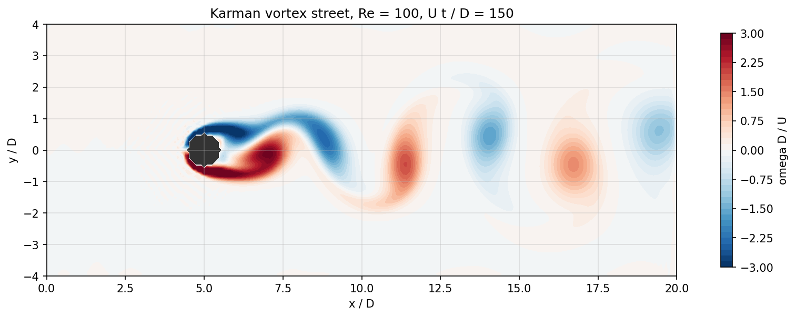
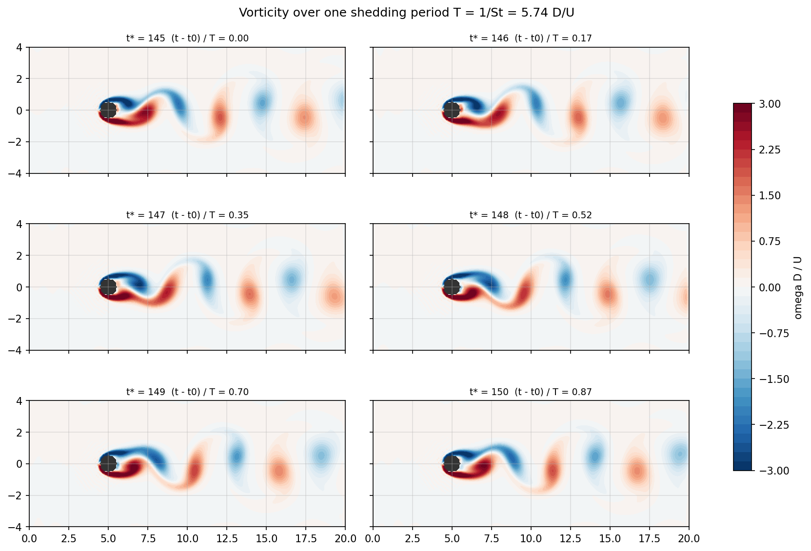
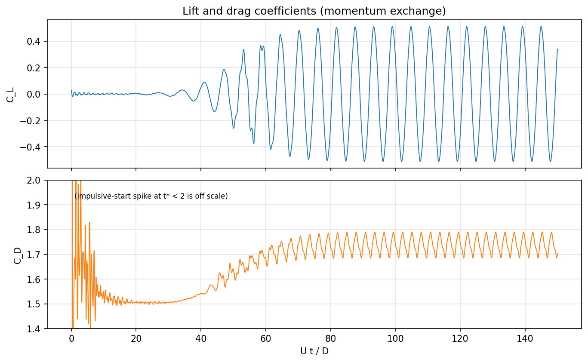
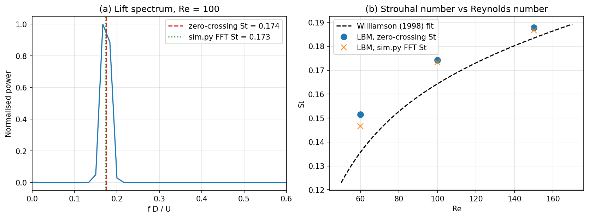

# Experiment 4: Kármán Vortex Street behind a Circular Cylinder

**Author:** 23BME048  
**Date:** October 2026

## Aim
Resolve the alternating vortex shedding behind a circular cylinder at $Re = 100$. Estimate the Strouhal number, mean drag and lift amplitude, and show the vorticity over one shedding cycle. As an extension, repeat at $Re = 60$ and $150$.

## Governing Equations
The incompressible Navier–Stokes equations are recovered in the low-Mach limit of the lattice-Boltzmann (LBM) equation with the BGK collision operator:

$$ f_i(\mathbf{x}+\mathbf{c}_i\Delta t,\ t+\Delta t) = f_i(\mathbf{x},t) - \frac{1}{\tau}\left[f_i - f_i^{eq}\right], \qquad f_i^{eq} = w_i\rho\left[1 + 3\,\mathbf{c}_i\cdot\mathbf{u} + \tfrac92(\mathbf{c}_i\cdot\mathbf{u})^2 - \tfrac32|\mathbf{u}|^2\right] $$

with $\rho = \sum f_i$, $\rho\mathbf{u} = \sum \mathbf{c}_i f_i$, kinematic viscosity $\nu = (\tau - \tfrac12)/3$, $Re = U D/\nu$ and $St = fD/U$.

## Methodology
- D2Q9 lattice; the cylinder sits at $x = 0.25\,n_x$ on the channel centreline.
- Half-way bounce-back on the cylinder surface; forces by the momentum-exchange method.
- Equilibrium inflow at $U = 0.1$ (lattice units), zero-gradient outflow, periodic top and bottom boundaries (a far-field approximation).
- A small initial transverse perturbation triggers the instability.
- **Strouhal number:** `sim.py` estimates St from an FFT of the lift signal. Its frequency resolution is only $1/T_{window}$, so `parametric.py` also measures the mean period between upward zero-crossings of $C_L$ after $tU/D = 90$, which is more precise.

**Table 1: Parameter set.**

| Parameter | Value | Parameter | Value |
| :--- | :--- | :--- | :--- |
| Lattice $n_x \times n_y$ | 241 × 97 | Cylinder diameter $D$ | 12 lattice cells |
| Reynolds number | 100 (also 60, 150) | Relaxation time $\tau$ | 0.536 |
| Outer steps × sub-steps | 4500 × 4 | Final time $tU/D$ | 150 |
| Blockage $D/H$ | 12.4 % | Frame output | every 1 $D/U$ |

## Results & Discussion

**Vortex street.** Figure 1 shows the developed Kármán street at $Re = 100$: alternating counter-rotating vortices leave the upper and lower shear layers and convect downstream in two staggered rows.

  
*Figure 1: Non-dimensional vorticity at $tU/D = 150$.*

**One shedding cycle.** Figure 2 shows six frames, one $D/U$ apart, covering ~0.87 of a shedding period ($T = 1/St = 5.74\,D/U$). The upper (negative) shear layer rolls up and detaches, then the lower (positive) one does the same half a period later.

  
*Figure 2: Vorticity sequence over one shedding cycle.*

**Forces.** In Figure 3 the lift stays near zero until $tU/D \approx 40$, then the instability grows exponentially and saturates into a periodic oscillation from $tU/D \approx 75$. Drag oscillates around its mean at twice the lift frequency (spectral peak at $fD/U \approx 0.35$) with an amplitude of only 0.05, one-tenth of the lift amplitude. The large drag spike at $t \to 0$ is caused by the impulsive start.

  
*Figure 3: Lift and drag coefficient histories at $Re = 100$.*

**Strouhal number.** Figure 4 and the table below compare the results with Williamson's (1998) empirical laminar-shedding fit $St = -3.3265/Re + 0.1816 + 1.6\times10^{-4}Re$.

| $Re$ | $St$ (zero-crossing) | $St$ (sim.py FFT) | $St$ Williamson | Mean $C_D$ | $C_L$ amplitude |
| :---: | :---: | :---: | :---: | :---: | :---: |
| 60 | 0.152 | 0.147 | 0.136 | 1.80 | 0.23 |
| 100 | **0.174** | 0.173 | 0.164 | 1.74 | 0.51 |
| 150 | 0.188 | 0.187 | 0.183 | 1.76 | 0.74 |

The solver reproduces the rise of St with Re and lies 3–12 % above the unconfined reference. The main reason is confinement: the periodic top/bottom boundaries with 12.4 % blockage accelerate the flow past the cylinder and raise both the shedding frequency and the drag (unconfined $C_D \approx 1.35$ at $Re = 100$). The resolution of only 12 cells per diameter also contributes. The lift amplitude grows strongly with $Re$, as expected. After the start-up transient ($tU/D > 10$) the largest density deviation is 2.5 %, consistent with weakly compressible flow.

  
*Figure 4: (a) lift spectrum at $Re = 100$; (b) Strouhal number against Reynolds number.*

## Conclusion
The D2Q9 BGK lattice-Boltzmann solver captured periodic Kármán shedding. At $Re = 100$ it gave $St = 0.174$, $\bar C_D = 1.74$ and a lift amplitude of 0.51. The Strouhal–Reynolds trend agrees with the empirical fit, and the over-prediction of about 6 % is explained by the domain blockage and the coarse cylinder resolution. A wider domain (lower $D/H$) and more cells per diameter would move the results towards the unconfined values.

## Files and how to run
- `sim.py`: solver from the 20ME406P Colab lab notebook (unchanged); `common.py`: its shared utilities.
- `parametric.py`: this work's parameter set, runs and figures. Run `python parametric.py` (~2 minutes; it writes ~600 MB of VTK frames to `results/`).
