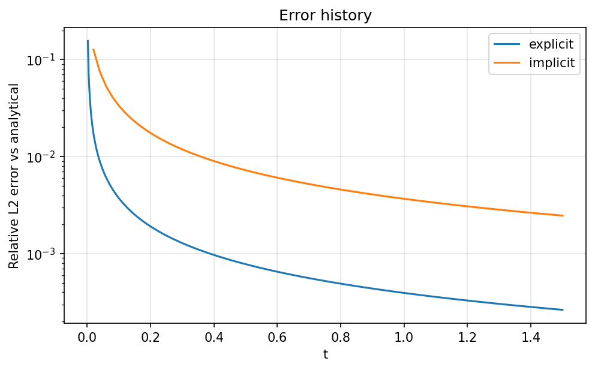
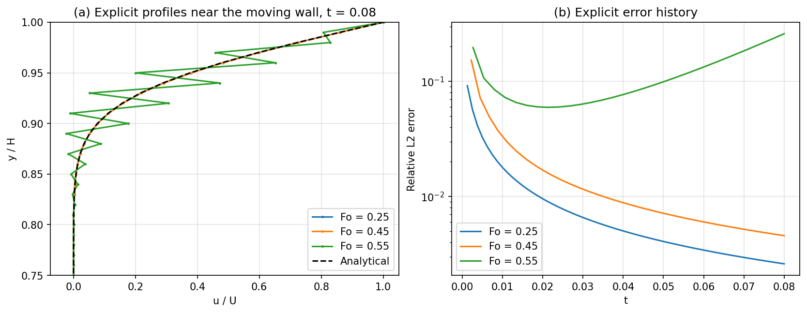
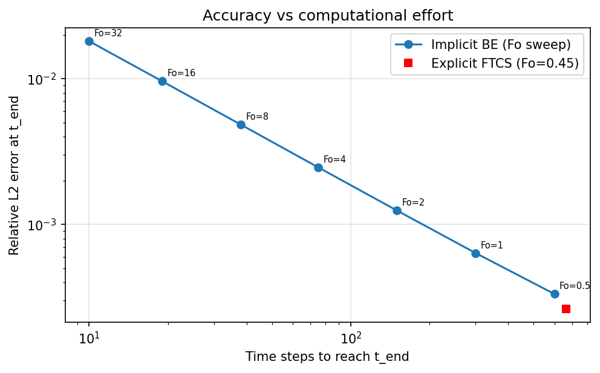

# Experiment 5: Transient Couette Flow

**Author:** 23BME048  
**Date:** October 2026

## Aim
Compare explicit (FTCS) and implicit (backward-Euler) solutions of transient momentum diffusion in Couette flow against the analytical series solution, and study the explicit stability limit and the accuracy–cost trade-off of the implicit scheme.

## Governing Equations
For laminar, fully developed flow between a stationary wall ($y=0$) and a wall that starts moving impulsively at speed $U$ ($y=H$), with $v=w=0$, $\partial p/\partial x = 0$ and $\partial u/\partial x = 0$, the $x$-momentum equation reduces to

$$ \frac{\partial u}{\partial t} = \nu \frac{\partial^2 u}{\partial y^2}, \qquad u(0,t)=0,\quad u(H,t)=U,\quad u(y,0)=0 . $$

The analytical solution used as the reference is

$$ \frac{u}{U} = \frac{y}{H} + \sum_{n=1}^{\infty} \frac{2(-1)^n}{n\pi}\sin\!\left(\frac{n\pi y}{H}\right) e^{-n^2\pi^2 \nu t / H^2}. $$

## Methodology
The domain is discretised with $N_y$ equally spaced nodes. With the Fourier number $Fo = \nu\,\Delta t/\Delta y^2$:

**Explicit FTCS:** $\; u_j^{n+1} = u_j^n + Fo\,(u_{j+1}^n - 2u_j^n + u_{j-1}^n)$, stable only for $Fo \le 0.5$.

**Implicit backward Euler:** $\; -Fo\,u_{j-1}^{n+1} + (1+2Fo)\,u_j^{n+1} - Fo\,u_{j+1}^{n+1} = u_j^n$, solved each step with the Thomas algorithm (TDMA); unconditionally stable.

The error is the relative $L_2$ norm against the 400-term series solution at the same time.

**Table 1: Parameter set.**

| Parameter | Value | Parameter | Value |
| :--- | :--- | :--- | :--- |
| Grid nodes $N_y$ | 101 | Channel height $H$ | 1.0 |
| Wall speed $U$ | 1.0 | Viscosity $\nu$ | 0.02 ($Re = UH/\nu = 50$) |
| End time $t_{end}$ | 1.5 | Explicit $Fo$ | 0.45 |
| Implicit $Fo$ | 4.0 | Stability study time | $t = 0.08$ |

## Results & Discussion

**Development of the profile.** Figure 1 shows the velocity profile at $t = 0.1, 0.5, 1.5, 5$ and $25$. Momentum diffuses from the moving wall into the fluid, and by $t = 25$ the profile is the linear steady Couette solution. Both schemes lie on the analytical curves at every time. At $t_{end}=1.5$ the explicit error is $2.6\times10^{-4}$ (667 steps) and the implicit error is $2.5\times10^{-3}$ (75 steps).

  
*Figure 1: Explicit (lines), implicit (circles) and analytical (dashed) velocity profiles at increasing times.*

**Error history.** In Figure 2 the error of both schemes is largest just after the impulsive start, when the profile is steepest, and falls as the profile smooths out. The implicit error is higher throughout because its time step is ~9 times larger, and backward Euler is only first-order accurate in time.

  
*Figure 2: Relative $L_2$ error against the analytical solution.*

**Stability boundary.** Figure 3 compares $Fo = 0.25, 0.45, 0.55$ at the same physical time $t = 0.08$. At $Fo = 0.25$ and $0.45$ the profiles are smooth and their errors keep falling ($2.6\times10^{-3}$ and $4.6\times10^{-3}$). At $Fo = 0.55$ a grid-scale (odd–even) oscillation appears near the moving wall, and the error starts to *grow* after $t \approx 0.02$, reaching 0.26 after only 30 steps. This is exactly the von Neumann result: the highest wavenumber mode is amplified by $|1-4Fo| = 1.2 > 1$ each step when $Fo > 0.5$.

  
*Figure 3: (a) explicit profiles near the moving wall and (b) explicit error growth at three Fourier numbers.*

**Computational effort.** Figure 4 sweeps the implicit Fourier number from 0.5 to 32. The error halves each time the step is halved (slope 1 on log–log axes), confirming first-order time accuracy. With 10 steps ($Fo = 32$) the implicit scheme still gives a 1.8 % error, where the explicit scheme would be unstable. For the same accuracy as explicit FTCS, however, the implicit scheme needs about the same number of steps, and each step costs a tridiagonal solve. Its real advantage is freedom from the stability limit, not accuracy per step.

  
*Figure 4: Error at $t_{end}$ against the number of time steps.*

## Conclusion
The 1D diffusion equation for transient Couette flow was solved with explicit FTCS and implicit backward-Euler schemes. Both converge to the analytical and steady linear profiles. The explicit scheme is accurate but strictly limited to $Fo \le 0.5$, failing through growing odd–even oscillations at $Fo = 0.55$. The implicit scheme stays stable at any $Fo$, so it can take very large steps when only moderate accuracy is needed, at the cost of first-order temporal error that grows linearly with $\Delta t$.

## Files and how to run
- `sim.py`: solver from the 20ME406P Colab lab notebook (unchanged); `common.py`: its shared utilities.
- `parametric.py`: this work's parameter set, runs and figures. Run `python parametric.py` (needs NumPy and Matplotlib); raw solver output goes to `results/`.
