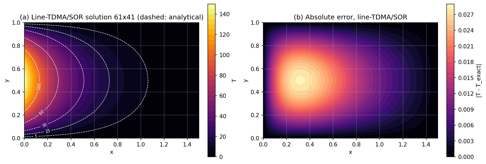
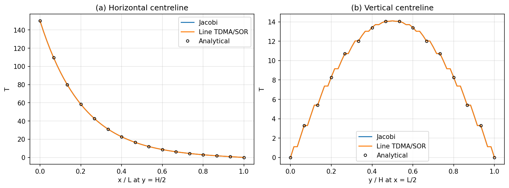
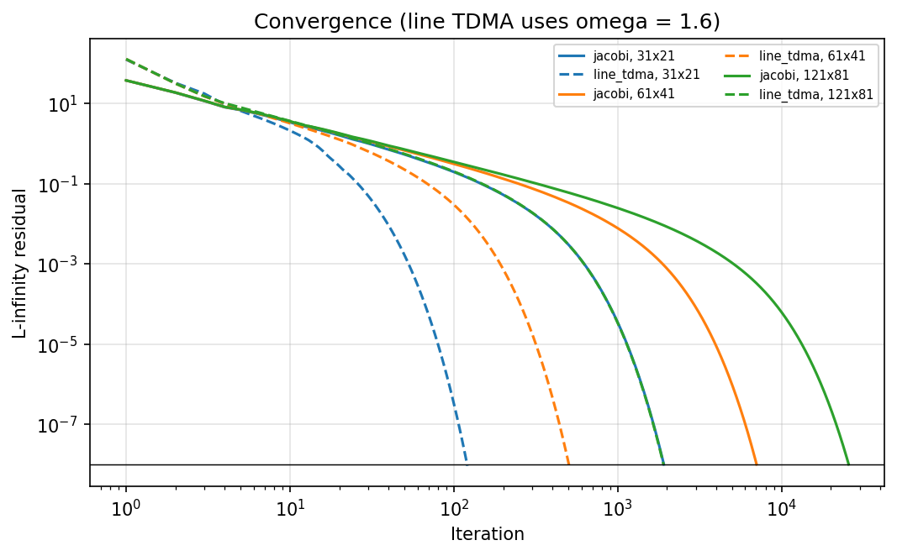
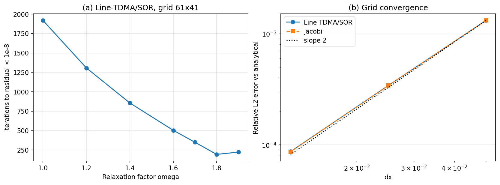

# Experiment 6: Two-Dimensional Plate Conduction

**Author:** 23BME048  
**Date:** October 2026

## Aim
Solve steady 2D heat conduction in a rectangular plate with point-Jacobi and line-TDMA/SOR iteration. Compare both with the analytical solution on three grids, and find the effect of the relaxation factor on convergence.

## Governing Equations
Steady conduction without heat generation reduces to the Laplace equation:

$$ \frac{\partial^2 T}{\partial x^2} + \frac{\partial^2 T}{\partial y^2} = 0, \qquad 0\le x\le L,\ 0\le y\le H $$

with $T(0,y) = T_L \sin(\pi y/H)$ and $T = 0$ on the other three edges. Separation of variables gives the exact solution

$$ T(x,y) = T_L\,\frac{\sinh\!\left(\pi (L-x)/H\right)}{\sinh(\pi L/H)}\,\sin\!\left(\frac{\pi y}{H}\right). $$

## Methodology
Second-order central differences with $\beta = (\Delta x/\Delta y)^2$:

$$ T_{i,j} = \frac{T_{i+1,j} + T_{i-1,j} + \beta\,(T_{i,j+1} + T_{i,j-1})}{2(1+\beta)} . $$

- **Point Jacobi:** every node is updated from the previous iterate.
- **Line TDMA/SOR:** each row is solved implicitly in $x$ with the Thomas algorithm, using the newest values of the neighbouring rows, then over-relaxed: $T^{new} = (1-\omega)T^{old} + \omega\,T^{TDMA}$.
- Convergence criterion: $\max|T^{k+1}-T^k| < 10^{-8}$.

**Table 1: Parameter set.**

| Parameter | Value | Parameter | Value |
| :--- | :--- | :--- | :--- |
| Plate $L \times H$ | 1.5 × 1.0 | Edge temperature amplitude $T_L$ | 150 |
| Grids | 31×21, 61×41, 121×81 | Tolerance | $10^{-8}$ |
| Base relaxation $\omega$ | 1.6 | $\omega$ sweep | 1.0 – 1.9 (61×41) |

## Results & Discussion

**Temperature field.** Figure 1(a) shows the line-TDMA/SOR solution on the 61×41 grid with the analytical isotherms overlaid; they are indistinguishable. Heat enters through the sinusoidal left edge and decays as $\sinh$ in $x$. The absolute error (Figure 1b) peaks at only 0.028 (0.02 % of $T_L$), in the interior near the heated edge where the curvature is largest.

  
*Figure 1: (a) temperature field with analytical isotherms; (b) absolute error.*

**Centreline profiles.** Both iterative methods match the analytical solution along both centrelines (Figure 2).

  
*Figure 2: Temperature along the horizontal and vertical centrelines.*

**Convergence and grid dependence.**

| Grid | Jacobi iterations | Jacobi $L_2$ error | Line-TDMA/SOR iterations | Line-TDMA/SOR $L_2$ error |
| :---: | :---: | :---: | :---: | :---: |
| 31 × 21 | 1 913 | $1.32\times10^{-3}$ | 121 | $1.32\times10^{-3}$ |
| 61 × 41 | 7 042 | $3.42\times10^{-4}$ | 504 | $3.42\times10^{-4}$ |
| 121 × 81 | 25 690 | $8.70\times10^{-5}$ | 1 905 | $8.72\times10^{-5}$ |

The two methods converge to the same discrete solution, so their errors are identical: the error comes from the discretisation, not the iterative solver. Halving the grid spacing divides the error by 3.85 and then 3.93, an observed order of about 1.97, which confirms second-order accuracy (Figure 4b). Jacobi's iteration count rises about 3.6× each time the grid is refined, as expected from its $O(N^2)$ convergence. Line-TDMA/SOR needs 13–16 times fewer iterations on every grid (Figure 3).

  
*Figure 3: Residual histories for both methods on the three grids.*

**Relaxation factor.** On the 61×41 grid the line-TDMA iteration count drops from 1918 ($\omega = 1$, line Gauss–Seidel) to 194 at $\omega = 1.8$, then rises again to 223 at $\omega = 1.9$ (Figure 4a). The optimum lies between 1.8 and 1.9. Beyond it, over-relaxation causes oscillatory overshoot, and convergence slows down again.

  
*Figure 4: (a) iterations against relaxation factor; (b) grid convergence of the $L_2$ error.*

## Conclusion
Both iterative schemes reproduced the analytical Laplace solution, and the discretisation was confirmed to be second-order accurate. Line-TDMA with SOR is far more efficient than point Jacobi: about 13–16× fewer iterations at $\omega = 1.6$, and the optimum $\omega \approx 1.8$ cuts the count by a further 2.6× (10× fewer than plain line Gauss–Seidel, $\omega = 1$). Jacobi's cost grows rapidly with grid refinement, making it impractical on fine grids.

## Files and how to run
- `sim.py`: solver from the 20ME406P Colab lab notebook (unchanged); `common.py`: its shared utilities.
- `parametric.py`: this work's parameter set, runs and figures. Run `python parametric.py` (~40 s).
