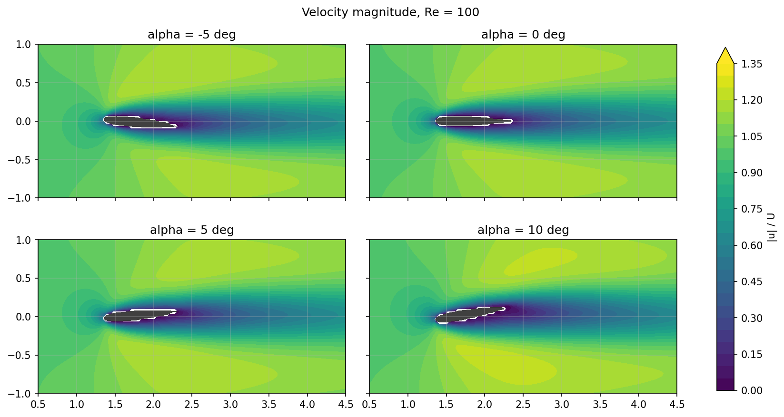
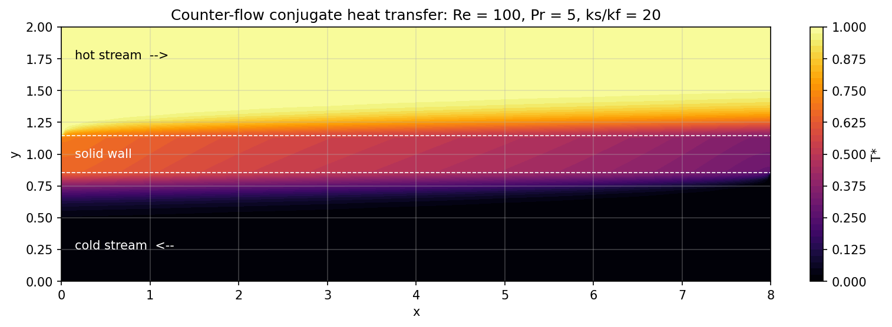
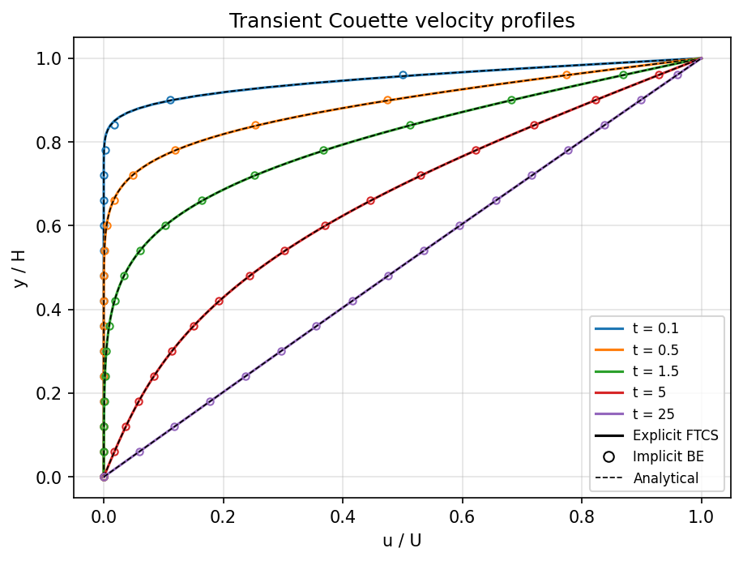

<div align="center">

# CFD and Heat Transfer — Numerical Experiments

**20ME406P · CFD and Heat Transfer Lab · Mechanical Engineering**

</div>

---

This repository collects six computational experiments of the **20ME406P CFD and Heat Transfer Lab**. Each experiment runs the lab's teaching solver with **its own parameter set** (grid, physical parameters and parametric sweeps). The results are post-processed into figures, and each experiment's README covers the aim, governing equations, methodology, results and conclusion.

## Experiments at a glance

<table>
  <tr>
    <td width="50%" valign="top">

### 1. External Flow over a NACA 0012 Airfoil

<a href="01_NACA0012_Airfoil/README.md"></a>

Angle-of-attack sweep at Re = 100 showing wake deflection, pressure and vorticity fields, and antisymmetric qualitative lift with nearly constant drag.

**Key methods:** Incompressible Navier–Stokes, volume penalisation (immersed boundary), projection method.

[Open experiment README →](01_NACA0012_Airfoil/README.md)

</td>
    <td width="50%" valign="top">

### 2. Double-Pipe Conjugate Heat Transfer

<a href="02_Double_Pipe_CHT/README.md"></a>

Counter-flow exchange through a conducting wall; effects of Reynolds number, conductivity ratio and flow arrangement on effectiveness, with energy conserved to machine precision.

**Key methods:** FVM convection–diffusion, harmonic-mean interface diffusivity, conjugate coupling.

[Open experiment README →](02_Double_Pipe_CHT/README.md)

</td>
  </tr>
  <tr>
    <td width="50%" valign="top">

### 3. Centrifugal Pump (SRF Model)

<a href="03_Centrifugal_Pump/README.md"></a>

Rotating annular passage from 1000 to 3000 rpm: centrifugal pressure rise, absolute vs relative velocities, and the affinity law H ∝ RPM² confirmed with R² = 1.

**Key methods:** Single rotating frame, polar-coordinate FVM, iterative thermal solution.

[Open experiment README →](03_Centrifugal_Pump/README.md)

</td>
    <td width="50%" valign="top">

### 4. Kármán Vortex Street

<a href="04_Cylinder_Vortex_Shedding/README.md"></a>

Periodic vortex shedding at Re = 60, 100 and 150; St = 0.174 at Re = 100 compared with Williamson's fit, plus lift/drag histories and a shedding-cycle sequence.

**Key methods:** D2Q9 BGK lattice Boltzmann, bounce-back, momentum-exchange forces, FFT and zero-crossing analysis.

[Open experiment README →](04_Cylinder_Vortex_Shedding/README.md)

</td>
  </tr>
  <tr>
    <td width="50%" valign="top">

### 5. Transient Couette Flow

<a href="05_Couette_Flow/README.md"></a>

Explicit FTCS vs implicit backward Euler against the series solution; instability at Fo = 0.55 and the accuracy–cost trade-off of large implicit steps.

**Key methods:** 1D FDM, von Neumann stability, TDMA.

[Open experiment README →](05_Couette_Flow/README.md)

</td>
    <td width="50%" valign="top">

### 6. 2D Plate Conduction

<a href="06_Plate_Conduction_2D/README.md"></a>

Laplace equation on three grids: point Jacobi vs line-TDMA/SOR, second-order grid convergence, and an optimal relaxation factor near 1.8.

**Key methods:** FDM, point Jacobi, line-implicit TDMA with SOR.

[Open experiment README →](06_Plate_Conduction_2D/README.md)

</td>
  </tr>
</table>

---

## Numerical methods and concepts

Across the experiments, the work covers:

- **Discretisation:** finite difference, finite volume and lattice-Boltzmann methods.
- **Time integration:** explicit and implicit schemes, Fourier-number stability limits and von Neumann analysis.
- **Linear solvers:** Jacobi, line-TDMA, SOR and the Thomas algorithm.
- **Flow solvers:** projection method, immersed-boundary penalisation and lattice-Boltzmann bounce-back.
- **Heat transfer:** steady conduction, convection–diffusion and conjugate heat transfer.
- **Verification and validation:** analytical solutions, grid convergence, conservation checks and the Williamson Strouhal-number fit.

## Repository structure

Each experiment folder contains the lab solver (`sim.py` + `common.py`, unchanged from the lab notebooks), `parametric.py` (this work's parameter set, runs and plotting), the result figures and a README.

```text
.
├── 01_NACA0012_Airfoil/
├── 02_Double_Pipe_CHT/
├── 03_Centrifugal_Pump/
├── 04_Cylinder_Vortex_Shedding/
├── 05_Couette_Flow/
├── 06_Plate_Conduction_2D/
└── README.md
```

## Reproducing the results

Requires Python 3.9+ with NumPy and Matplotlib:

```bash
pip install numpy matplotlib
cd 05_Couette_Flow
python parametric.py          # regenerates Figure_*.png; raw solver output goes to results/
```

Most experiments finish within seconds; the cylinder study takes about 2 minutes.

## Note

These are educational numerical models. Experiments 1 and 3 are reduced teaching models, not industrial CFD solvers. Their assumptions and limitations are documented in the individual READMEs, and the results should be read within those modelling choices.

---

<div align="center">

**23BME048** · Mechanical Engineering

</div>
